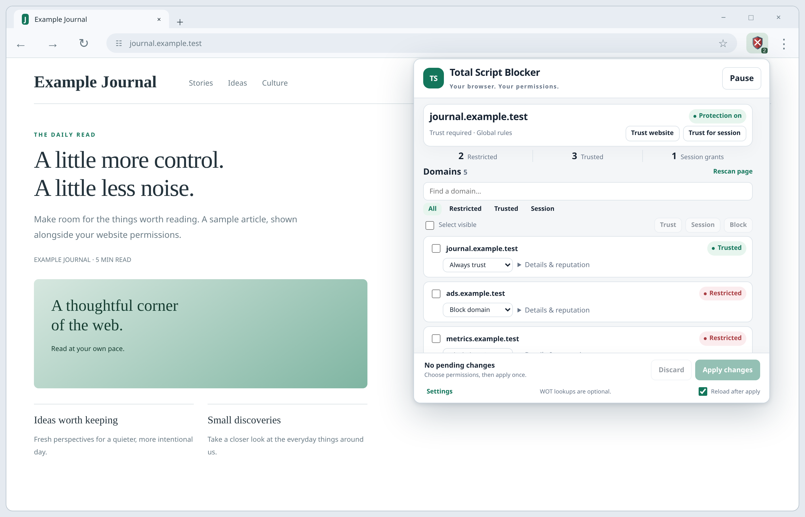
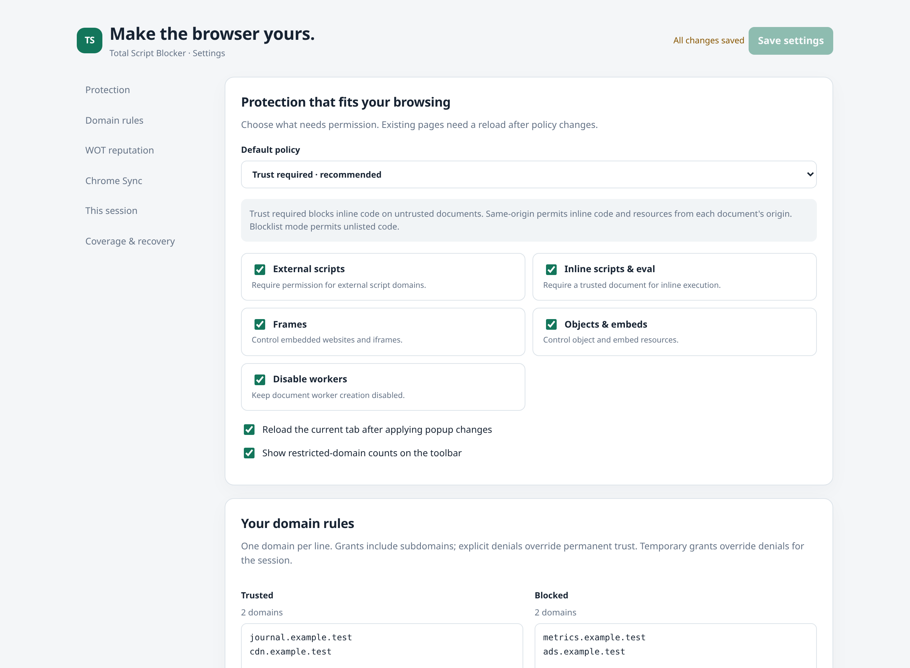
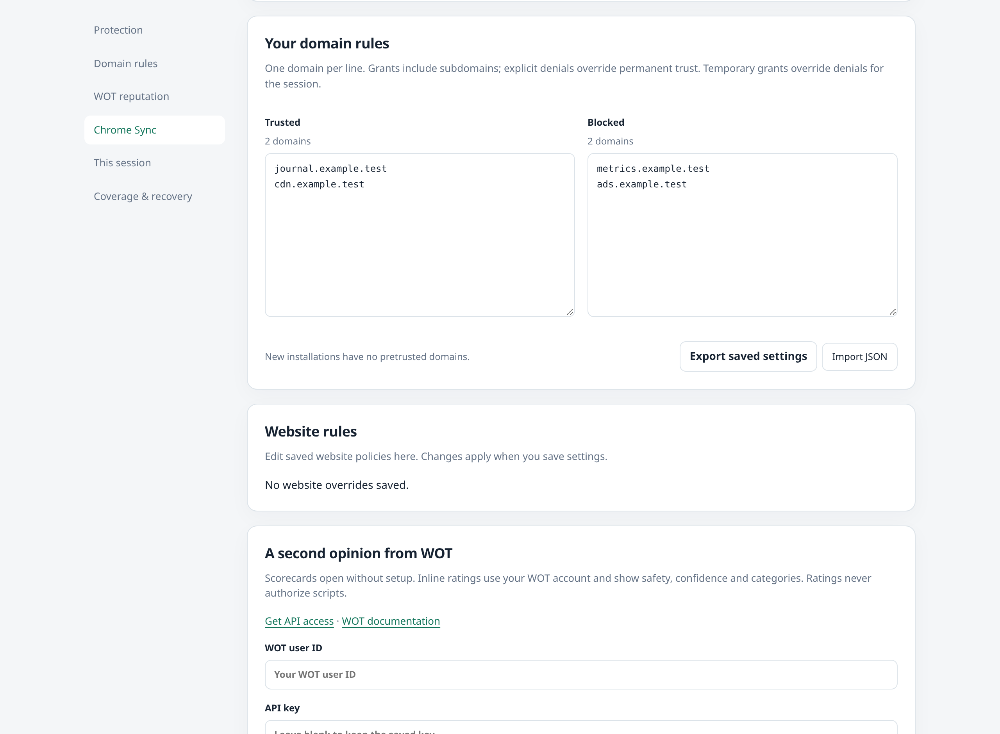

<p align="center">
  
</p>

<h1 align="center">Total Script Blocker</h1>

<p align="center"><strong>Your browser. Your permissions.</strong></p>

<p align="center">
  Control which websites can run scripts, load frames and embed content.<br>
  Trust the domains you need, for as long as you need them.
</p>

<p align="center">
  <a href="https://github.com/PrimeN/Total-Script-Blocker/actions/workflows/test.yml"></a>
  <a href="https://github.com/PrimeN/Total-Script-Blocker/releases/latest"></a>
  
  
  <a href="LICENSE"></a>
</p>

<p align="center">
  <a href="https://github.com/PrimeN/Total-Script-Blocker/stargazers"></a>
  <a href="https://github.com/PrimeN/Total-Script-Blocker/issues"></a>
  <a href="https://github.com/PrimeN/Total-Script-Blocker/commits/"></a>
</p>

<p align="center">
  <a href="https://github.com/PrimeN/Total-Script-Blocker/releases/latest">Download</a> ·
  <a href="#features">Features</a> ·
  <a href="#screenshots">Screenshots</a> ·
  <a href="#install">Install</a> ·
  <a href="docs/usage.md">Usage guide</a> ·
  <a href="docs/privacy-and-permissions.md">Privacy &amp; permissions</a> ·
  <a href="https://github.com/PrimeN/Total-Script-Blocker/issues/new?title=%5BBug%5D%20">Report a bug</a>
</p>

## Decide what gets to run

Total Script Blocker is an extension for Chrome and compatible Chromium browsers.
By default, websites need your permission to run inline or external scripts, load
frames and use object/embed resources. Separate controls let you adjust those
restrictions and disable document workers.

Open the toolbar popup to review discovered domains and apply several permission
changes together. Keep a permanent rule, grant temporary access, or scope a rule
to the website you're visiting.

## Screenshots



| Protection settings | Domain rules |
| --- | --- |
|  |  |

The extension UI uses representative permission data. Browser framing and the
example website are illustrative.

[View the full gallery: light/dark popups, pending changes, settings and Chrome Sync →](docs/gallery.md)

## Features

| | What you can do |
| --- | --- |
| **Domain permissions** | Trust or block domains and their subdomains, and return exact rules to inherited policy |
| **Temporary access** | Grant access for the browser session or for 5 minutes, 30 minutes or 1 hour; extend or revoke grants |
| **Website rules** | Keep global permissions or allow/block domains only in the context of a particular website |
| **Protection modes** | Choose Trust required, Same-origin or Blocklist, with separate script, frame, object and worker controls |
| **Batch editing** | Filter domains, select several, stage changes, discard or apply once, and undo permission edits |
| **Domain discovery** | Review page declarations, observed requests and browser/CSP denials with evidence labels |
| **Chrome Sync** | Optionally sync saved rules and preferences, resolve conflicting copies and restore a local backup |
| **Import & export** | Back up saved settings as JSON and import them on another installation |
| **Optional WOT reputation** | Open domain scorecards or use your own WOT credentials for inline ratings |
| **Site cleanup** | Clear the current origin's local/session storage, IndexedDB, CacheStorage and service workers while keeping cookies |
| **Appearance** | Compact toolbar controls, a dedicated settings dashboard and automatic light/dark styling |

No account or API key is needed for blocking. WOT API lookups are optional and
have separate account and access requirements.

## Install

Requires **Chrome 120+**, or a Chromium browser supporting the Manifest V3 APIs
used by the extension. Browser API and Chrome Sync support can vary.

1. Download the extension ZIP from the [latest release](https://github.com/PrimeN/Total-Script-Blocker/releases/latest).
2. Extract the ZIP. Keep the extension folder in a permanent location;
   it must contain `manifest.json`.
3. Open **`chrome://extensions`** and enable **Developer mode**.
4. Select **Load unpacked** and choose that folder.
5. Pin **Total Script Blocker** to the toolbar for quick access.
6. Reload websites you already had open so document policies take effect.

To install from source instead, use **Code → Download ZIP** or
`git clone https://github.com/PrimeN/Total-Script-Blocker.git`, then load the folder
containing `manifest.json` using the same steps above.

For a packaged copy from [GitHub Actions](https://github.com/PrimeN/Total-Script-Blocker/actions/workflows/test.yml),
extract the downloaded artifact and the extension ZIP inside it, then load the
folder containing `manifest.json`. GitHub may require sign-in to download artifacts.

## Start with a website you trust

1. Open a website, then open Total Script Blocker from the toolbar.
2. Review its domains. Trust only the site and supporting domains you need.
3. Choose permanent or temporary permissions. Use **Permission scope & duration**
   for website-only rules and timed grants.
4. Select **Apply changes**. The popup can reload the tab after applying.

**Trust website** grants the site's domain and subdomains; unrelated third-party
domains keep their own permissions. Temporary grants apply across websites and
override matching permanent denials until revoked or expired.

The toolbar count represents **distinct discovered domains restricted by policy**,
not blocked requests. An observation or reputation rating does not prove that
code ran or that a domain is safe.

[Permission scopes, inheritance and everyday controls →](docs/usage.md)

## Optional integrations

| Integration | Setup | What is shared |
| --- | --- | --- |
| **Chrome Sync** | Enable extension syncing in Chrome, then choose the settings copy to use in the extension's Settings | Saved domain rules, protection controls and toolbar preferences through Google's sync service |
| **WOT scorecards** | Click a domain's scorecard link; no API credentials needed | Opens the selected domain's scorecard on mywot.com |
| **WOT inline ratings** | Enter your own WOT user ID and API key in Settings | Sends the selected hostname to WOT's API; automatic lookups are off by default |

[WOT developer access](https://www.mywot.com/developers) ·
[WOT API documentation](https://support.mywot.com/hc/en-us/articles/360024398673-3-Using-the-API)

WOT access and quotas depend on your provider account. Ratings never authorize
scripts automatically. WOT credentials are excluded from settings exports and
Chrome Sync; blocking works without them.

## Privacy and coverage

Rules and preferences use browser extension storage. Discovered hostnames and
temporary state stay in browser-session storage. Discovery records hostnames,
resource types and evidence labels, rather than URL paths, query strings or
request bodies. The extension has no developer-operated server, analytics or
telemetry.

Enforcement uses browser request rules and appended Content Security Policy on
HTTP/HTTPS pages. It cannot undo code that already ran, override stricter website
policies, or cover every service-worker/cache-generated document. Browser and
extension pages, non-network documents, file/FTP URLs and incognito are outside
this version's coverage.

[Why each permission is needed](docs/privacy-and-permissions.md) ·
[Full privacy policy](<Privacy policy.txt>)

## Development

The extension uses JavaScript modules, HTML and CSS without a frontend build step.
Run the unit checks with **Node.js 22+**:

```sh
npm test
```

Create a distributable ZIP and an unpacked directory with **Python 3**:

```sh
python3 scripts/package.py
```

Output is written to `dist/`, including `unpacked/` and a SHA-256 checksum file.
Packaging excludes tests, documentation and repository metadata.

The [extension-check workflow](https://github.com/PrimeN/Total-Script-Blocker/actions/workflows/test.yml)
also runs Chromium integration checks and packages the extension. Production
pushes automatically publish downloadable builds; new manifest versions create
numbered releases with changelog notes.

[Release workflow guide](docs/releasing.md) · [Changelog](CHANGELOG.md)

## Help and contribute

[Report a bug](https://github.com/PrimeN/Total-Script-Blocker/issues/new?title=%5BBug%5D%20)
with your browser/version, operating system, protection mode and steps to
reproduce it. For a website issue, describe the expected behaviour and permission
scope. Remove WOT credentials and private browsing information from attachments.

[Suggest a feature](https://github.com/PrimeN/Total-Script-Blocker/issues/new?title=%5BFeature%5D%20)
with an example of how you would use it. Focused pull requests are welcome; include
relevant checks for behaviour changes.

## License

See the [GNU GPL v3 license](LICENSE) and [retained copyright and license notices](License.txt).
Third-party services retain their own terms. Total Script Blocker is not affiliated
with or endorsed by Google or WOT.
