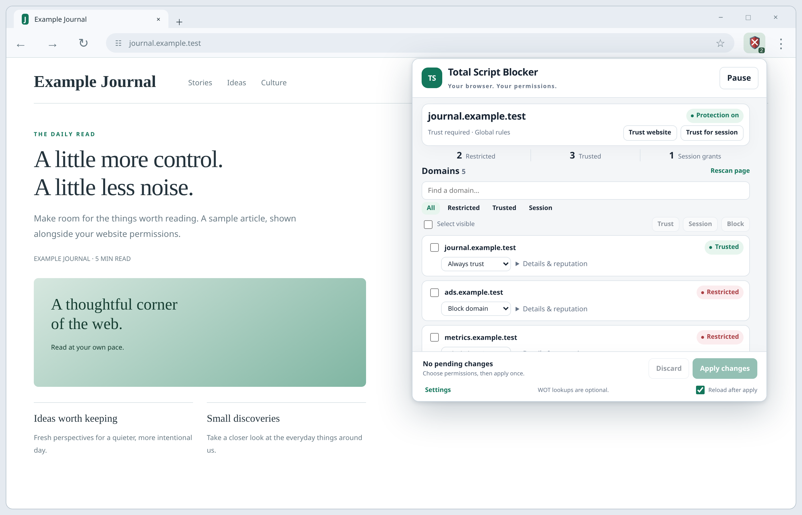
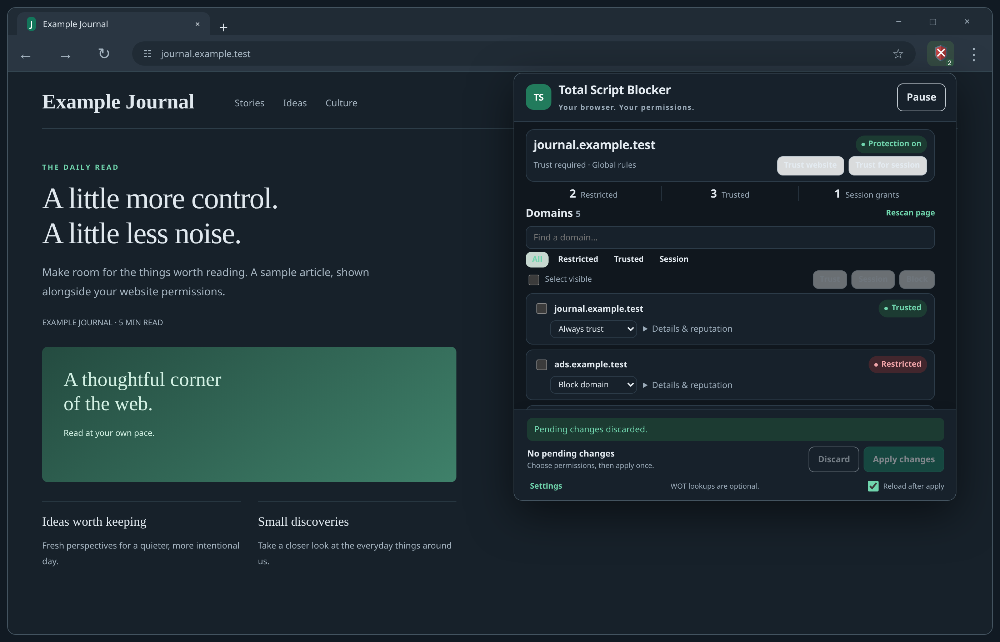
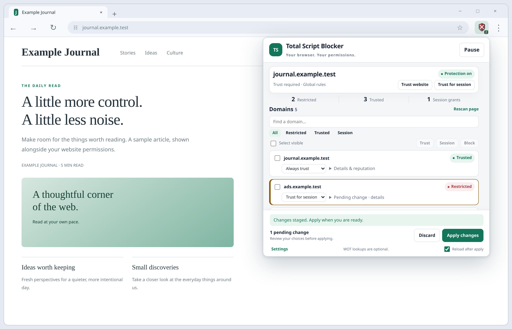
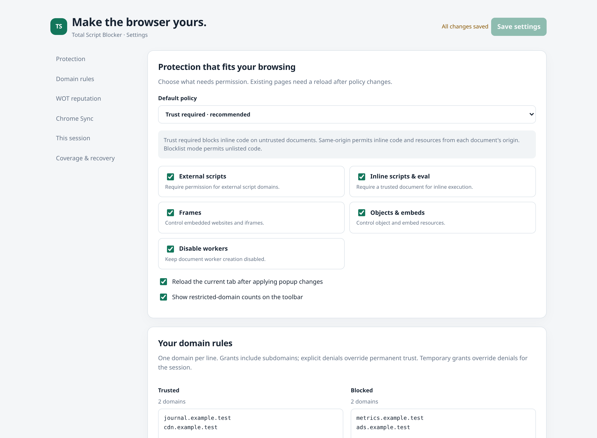
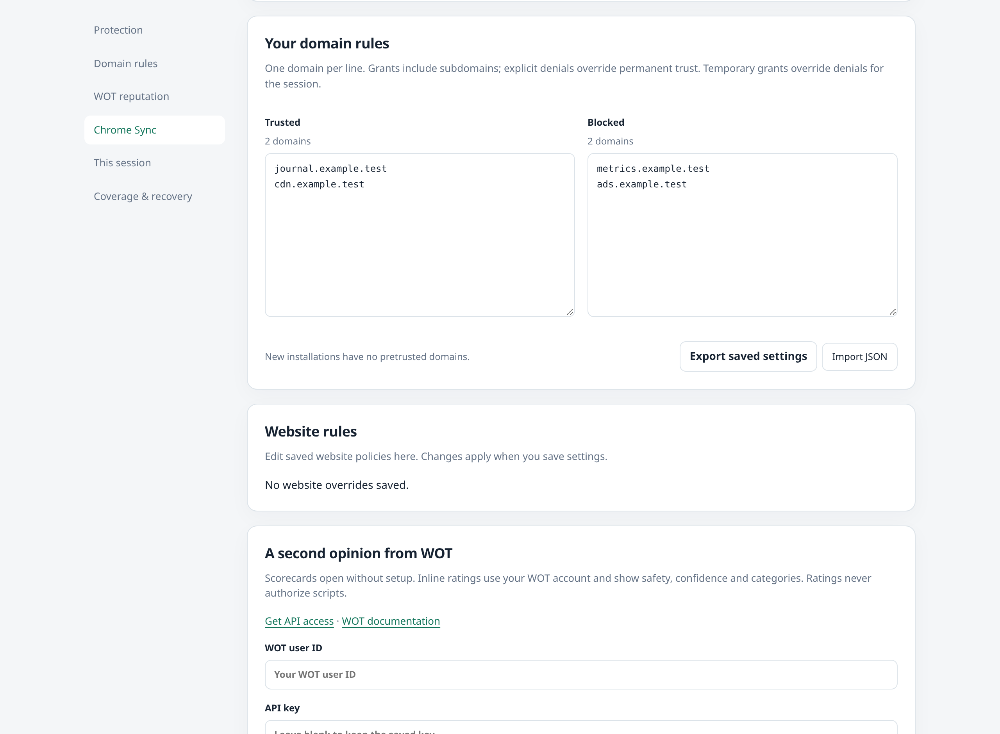
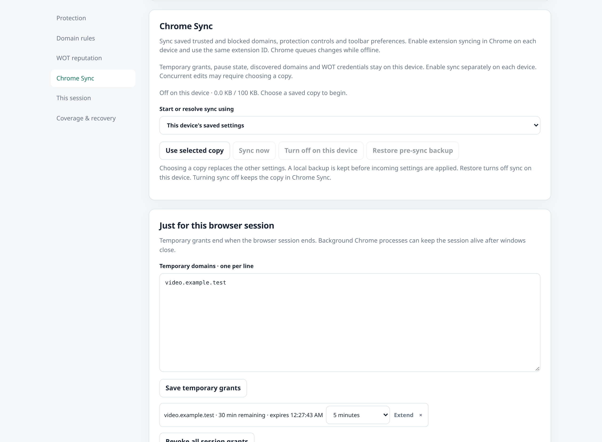

# Total Script Blocker on screen

The extension UI is rendered from its existing HTML, CSS and JavaScript with
representative domain and permission data. Popup views include illustrative browser
framing to show where the panel opens beneath the toolbar icon. No personal
browsing history or WOT credentials are shown.

## Toolbar popup

| Light | Dark |
| --- | --- |
|  |  |

## Review before applying

## Protection settings

## Saved domain rules

## Optional Chrome Sync

[Usage guide](usage.md) · [Privacy and permissions](privacy-and-permissions.md) · [Back to the README](../README.md)
